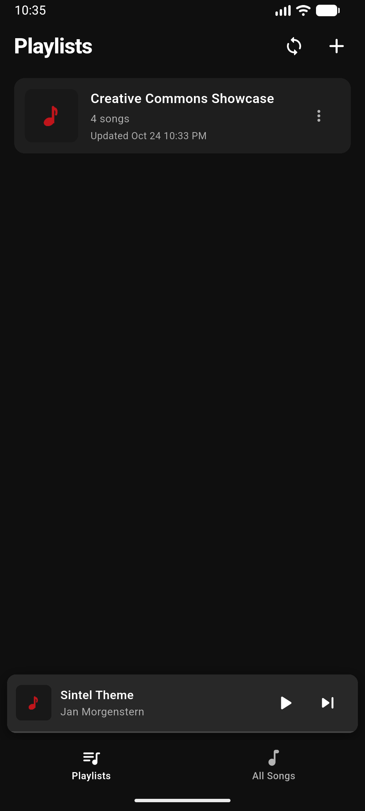
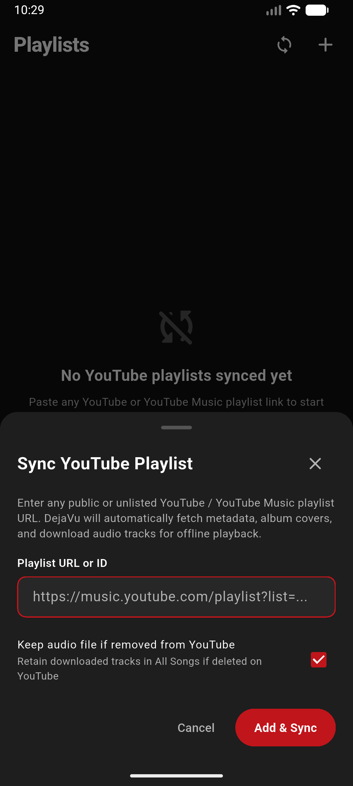
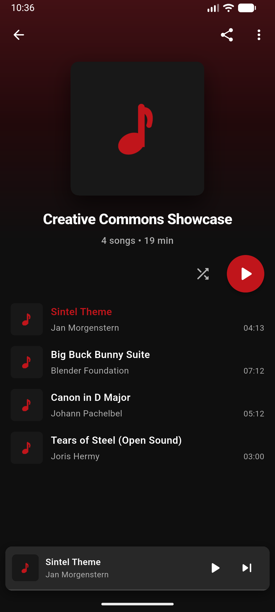
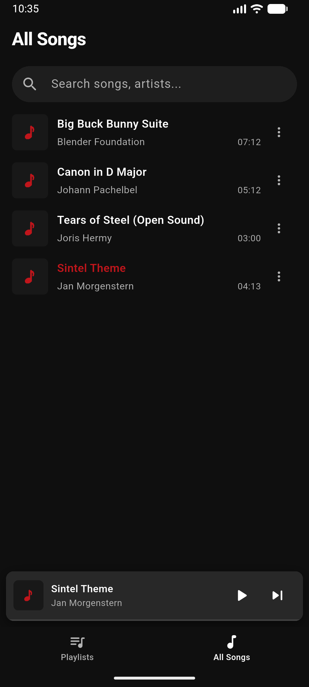
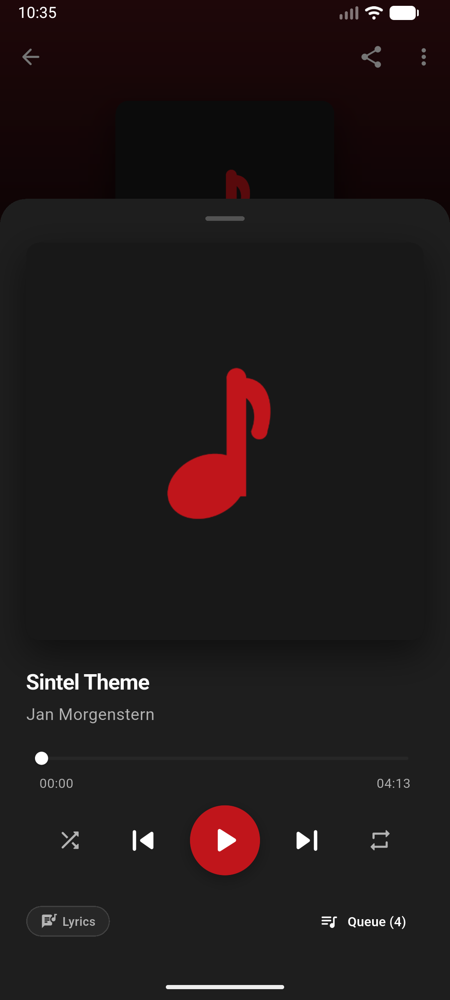
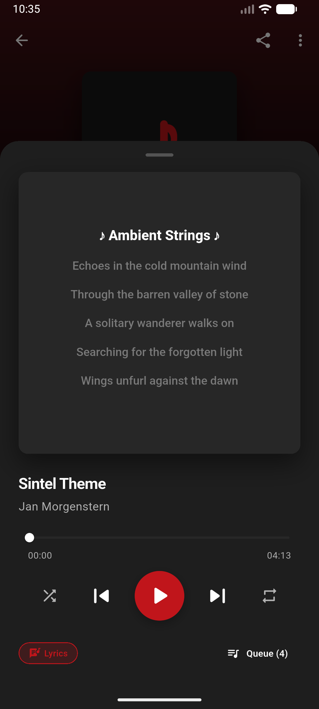

# ⚡ DejaVu Playlist Sync

> 📁 **An offline playlist synchronizer and media archiver for public, Creative Commons, podcast, and educational playlists.**

[](https://flutter.dev)
[](https://dart.dev)
[](LICENSE)
[](https://github.com/ZeroRetro/dejavu-playlist-sync/releases)
[](https://github.com/ZeroRetro/dejavu-playlist-sync)

---

> [!TIP]
> ### 🤖 100% Vibecoded
> **DejaVu Playlist Sync is vibecoded!**
> Conceived, architected, debugged, and polished through collaborative AI pair programming. Every line of code, performance optimization, and sleek UI pixel was crafted in the flow of pure vibecoding vibes.

---

## 📲 Direct APK Download

Ready to listen offline? Grab the latest Android release from our official GitHub Releases:

[](https://github.com/ZeroRetro/dejavu-playlist-sync/releases)

* **Official Releases**: [**github.com/ZeroRetro/dejavu-playlist-sync/releases**](https://github.com/ZeroRetro/dejavu-playlist-sync/releases)
* **Package**: `DejaVu-Playlist-Sync.apk` *(Universal APK, Android 8.0+ / API 26+)*
* **How to Install**:
  1. Head over to [**Releases**](https://github.com/ZeroRetro/dejavu-playlist-sync/releases) and download the latest `DejaVu-Playlist-Sync.apk`.
  2. Tap the download notification or open the file in your device's **Downloads** folder.
  3. If prompted by Android, enable **Install unknown apps** for your browser or file manager.
  4. Tap **Install** and enjoy DejaVu!

---

## 🎧 What is DejaVu?

**DejaVu Playlist Sync** is an open-source offline media archiver and player. It synchronizes public and unlisted media playlists (such as Creative Commons tracks, podcasts, educational lectures, and personal media archives) directly to your local device for seamless, data-free offline listening.

Archive your playlists once to eliminate mobile bandwidth usage, and enjoy lossless, high-fidelity audio anywhere—on flights, road trips, subway commutes, or whenever you are completely off the grid.

---

## 📱 Screenshots & User Experience

| Playlists Library | Sync Playlist Modal | Playlist Detail |
|:---:|:---:|:---:|
|  |  |  |

| All Songs & Search | Now Playing Sheet | Synchronized Lyrics |
|:---:|:---:|:---:|
|  |  |  |

### Core Capabilities:
* **Playlists Library**: Clean, fast overview of synchronized media playlists with track counts, background sync state, and quick re-sync actions.
* **Streamlined Media Syncing**: Input any public or unlisted web playlist URL to parse metadata, save audio in native lossless M4A/AAC, embed 1:1 square artwork, and fetch synchronized lyrics.
* **Detailed Playlist Inspection**: Full tracklists with duration formatting, ambient crimson gradient header, and clean track items without unnecessary clutter.
* **Unified Offline Songs List**: Instant access to all cached audio tracks across your entire library in one searchable list.
* **Interactive Synchronized Lyrics**: Real-time timestamped LRC lyrics with smooth auto-scroll and seek-on-tap.
* **Full-Featured Audio Player**: Hardware-accelerated gapless playback, interactive seek scrubber, dynamic queue sheet, shuffle, loop, and persistent lock-screen background media controls.
* **Smart Orphan Protection**: Delete playlists without losing audio files shared across other playlists in your local library.

---

## 🚀 How to Use

1. **Copy a Playlist Link**:
   - Copy a link to any public or unlisted media playlist (e.g. YouTube).
   - *Note: Playlists can be **public** or **unlisted** (accessible to anyone with the URL).*
   - Example format:
     ```
     https://www.youtube.com/playlist?list=...
     ```

2. **Sync in DejaVu**:
   - Open DejaVu and tap the **+** button in the top right.
   - Paste your playlist link and tap **Add & Sync**.
   - DejaVu will fetch the tracks, cover art, and synchronize the audio in the background.

3. **Enjoy Offline**:
   - Tap any song to start playing.
   - Use the floating mini-player or tap it to open the full player with scrubber and queue controls.
   - Use **Shuffle** or **Play** to listen hands-free.

---

## 💡 Frequently Asked Questions (FAQ)

<details>
<summary><b>Do playlists need to be public?</b></summary>
<p>No! Playlists do <b>not</b> need to be public. Any <b>unlisted / hidden</b> playlist (accessible to anyone who has the link) works just as smoothly as a public playlist. Only private playlists requiring personal login credentials cannot be accessed.</p>
</details>

<details>
<summary><b>Do I need an account or login?</b></summary>
<p>No account or sign-in is required. DejaVu syncs publicly accessible and unlisted playlist links directly without any login credentials or API keys.</p>
</details>

<details>
<summary><b>Does media continue playing when my screen is off?</b></summary>
<p>Yes. DejaVu is fully integrated with Android's system audio service, supporting lock-screen playback controls, notification controls, and Bluetooth headset gestures.</p>
</details>

<details>
<summary><b>How does delta-sync handle remote playlist changes?</b></summary>
<p>DejaVu tracks sync differences cleanly. If a track is removed or unlinked from a remote playlist, your existing local files remain preserved in your offline library unless you choose to prune them.</p>
</details>

<details>
<summary><b>Can I remove a playlist without deleting media used in other playlists?</b></summary>
<p>Yes. When removing a playlist, you can choose whether to keep or delete local audio files. If another playlist in your library shares those songs, DejaVu automatically protects them from deletion.</p>
</details>

---

## 🛠️ For Developers & Power Users

<details>
<summary><b>Technical Architecture & Build Instructions</b></summary>

### Tech Stack
- **Framework**: [Flutter 3.x](https://flutter.dev) & [Dart 3](https://dart.dev)
- **State Management**: [Riverpod 2.x](https://riverpod.dev) (`flutter_riverpod`)
- **Database**: [Drift](https://drift.simonbinder.eu/) (reactive SQLite with foreign key cascades)
- **Audio Engine**: [just_audio](https://pub.dev/packages/just_audio), [just_audio_background](https://pub.dev/packages/just_audio_background), [audio_session](https://pub.dev/packages/audio_session)
- **Demuxing**: Native Android `MediaExtractor` & `MediaMuxer` (lossless AAC `.m4a` extraction)

### Building from Source
```bash
# 1. Clone the repository
git clone https://github.com/ZeroRetro/dejavu-playlist-sync.git
cd dejavu-playlist-sync

# 2. Install dependencies
flutter pub get

# 3. Generate SQLite and Riverpod code (if modified)
dart run build_runner build --delete-conflicting-outputs

# 4. Run tests
flutter test

# 5. Run the app on your device or emulator
flutter run
```
</details>

---

## ⚖️ Acceptable Use & Legal Disclaimer

**DejaVu Playlist Sync** is developed strictly as a personal media archiving utility intended for authorized personal backups, educational materials, public domain recordings, podcasts, and Creative Commons audio.

* **Open-Source & Educational**: This repository provides free, open-source software under the MIT License for personal archiving and technical research.
* **Respect for Intellectual Property**: The developers do not promote, condone, or encourage copyright infringement. Users bear sole responsibility for confirming the copyright and licensing terms of any media synced or archived through this software.
* **Terms of Service**: Users are solely responsible for complying with all applicable local copyright legislation and third-party Terms of Service.
* **No Circumvention or Proprietary Keys**: DejaVu does not bypass Technological Protection Measures (TPMs), decrypt proprietary encrypted streams, or package private API keys. It queries publicly available endpoints using open-source community libraries.

---

## 🏷️ Trademarks & Nominative Fair Use

YouTube and YouTube Music are registered trademarks of Google LLC. DejaVu Playlist Sync is an independent open-source project and is not affiliated with, sponsored by, or endorsed by Google LLC, YouTube, or any of their affiliates. All trademarks, service marks, and company names referenced are for identification and compatibility purposes only and remain the property of their respective owners.

---

## 📄 License

This project is licensed under the [MIT License](LICENSE).
